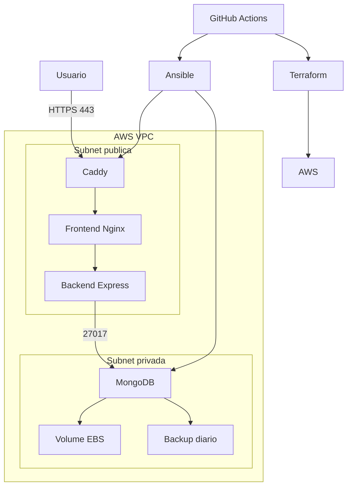

# ToDo App — Mensal 4

## Integrantes — Grupo 22

- João Victor da Silva Siqueira
- Carlos de Mello Feliponi
- Lucas Eduardo Schneider Wiggers


Projeto acadêmico de Engenharia de Software voltado à implantação automatizada de uma aplicação em nuvem utilizando Terraform, Ansible, Docker e GitHub Actions.

A aplicação permite cadastrar, listar, concluir, reabrir e excluir tarefas.

## Tecnologias

- Frontend: React e Nginx.
- Backend: Node.js, Express e Mongoose.
- Banco de dados: MongoDB.
- Infraestrutura: AWS EC2, VPC e EBS.
- Provisionamento: Terraform.
- Configuração e manutenção: Ansible.
- CI/CD: GitHub Actions.
- Registro de imagens: GitHub Container Registry.
- HTTPS: Caddy e DuckDNS.

## Arquitetura



A infraestrutura utiliza duas instâncias EC2 Ubuntu 24.04 na região us-east-1.

- Aplicação: t3.medium, em subnet pública.
- Banco de dados: t3.small, em subnet privada, sem IP público.
- VPC: 10.0.0.0/16.
- Subnet pública: 10.0.1.0/24.
- Subnet privada: 10.0.2.0/24.
- Armazenamento persistente: volume EBS gp3 de 10 GB para o MongoDB.
- Discos de sistema: 20 GB por instância.

O frontend e a API utilizam o mesmo domínio HTTPS. O banco de dados aceita conexões provenientes do servidor da aplicação. As portas internas não são expostas à internet.

Acesso durante a implantação:

https://todoapp-grupo22.duckdns.org

O endereço fica indisponível quando a infraestrutura é destruída.

## Estrutura do repositório

- frontend/: aplicação React.
- backend/: API Express.
- banco-de-dados/: configuração inicial do MongoDB.
- terraform/: definição da infraestrutura AWS.
- ansible/: configuração e manutenção dos servidores.
- scripts/: rotinas de deploy, backup e testes.
- .github/workflows/: pipelines de infraestrutura e aplicação.
- docs/: escopo original do projeto.

## Pré-requisitos

- Conta AWS com permissões para provisionamento.
- Git e Docker com Docker Compose.
- Terraform e Ansible.
- GitHub Actions com runner Linux self-hosted.
- Perfil AWS CLI denominado mensal4.
- Chave SSH mensal4 configurada no runner.
- Credenciais do MongoDB armazenadas em
  ~/.mensal4/database.env, fora do repositório.
- Domínio DuckDNS configurado.

O arquivo database.env deve conter as variáveis
MONGO_ROOT_PASSWORD e MONGO_APP_PASSWORD.

As credenciais não devem ser publicadas no GitHub.

## Pipeline de infraestrutura

A workflow Infrastructure CI permite executar as seguintes operações:

| Operação | Finalidade |
|---|---|
| plan | Visualizar alterações previstas |
| apply | Provisionar ou atualizar a infraestrutura |
| configure | Configurar e realizar manutenção nos servidores |
| destroy | Excluir a infraestrutura |

Parâmetros disponíveis:

| Parâmetro | Finalidade |
|---|---|
| instance_type | Selecionar t3.small ou t3.medium |
| update_os | Atualizar os pacotes do sistema operacional |
| extra_packages | Instalar pacotes adicionais |
| app_version | Implantar uma versão específica da aplicação |

Para criar o ambiente, execute a workflow com a operação apply.
Após o provisionamento, atualize o domínio DuckDNS com o IP público
da instância da aplicação.

O Terraform cria os recursos e o Ansible configura os servidores,
instala as dependências e inicia os serviços.

## Pipeline da aplicação

A workflow Application CI realiza:

- Validação do código.
- Construção das imagens Docker.
- Testes de integração.
- Publicação das imagens no GHCR.
- Implantação manual de versões.
- Retorno a versões anteriores.

As imagens são identificadas pelo hash do commit Git.

Para atualizar a aplicação, execute Application CI com a operação
deploy ou informe o hash da versão no parâmetro app_version
da pipeline de infraestrutura.

Para retornar a uma versão anterior, execute Application CI com
a operação rollback e informe o hash correspondente.

## Operações e manutenção

A administração dos servidores é realizada por SSH, utilizando
a instância pública como intermediária para acessar o banco.

Consultar os containers:

```bash
sudo docker ps
```

Consultar os logs:

```bash
sudo docker logs --tail 50 todo-app-backend-1
sudo docker logs --tail 50 todo-app-frontend-1
```

Verificar a saúde do backend:

```bash
sudo docker exec todo-app-backend-1 wget -qO- http://localhost:5000/health
```

Reiniciar a aplicação:

```bash
sudo docker restart todo-app-backend-1 todo-app-frontend-1
```

Consultar a versão implantada:

```bash
sudo cat /opt/todo-app/.version
```

## Backup e recuperação

O MongoDB utiliza armazenamento persistente em volume EBS.

O Ansible configura um backup diário às 03h UTC, com retenção
de sete dias.

Os backups ficam em /mnt/mongodb/backups/.

Para executar um backup manualmente no servidor do banco:

```bash
sudo /usr/local/bin/todo-backup.sh
```

Para testar a recuperação sem modificar o banco de produção:

```bash
sudo docker run -d --name mongo-restore-test --network none mongo:8.0
```

Após a inicialização do MongoDB temporário:

```bash
sudo cat /mnt/mongodb/backups/ARQUIVO.archive.gz | \
  sudo docker exec -i mongo-restore-test mongorestore \
  --archive --gzip --nsInclude="todo-app.*"
```

Consultar os dados recuperados:

```bash
sudo docker exec mongo-restore-test mongosh --quiet \
  --eval 'db.getSiblingDB("todo-app").todos.find().toArray()'
```

Remover o container temporário:

```bash
sudo docker rm -f -v mongo-restore-test
```

Antes de destruir a infraestrutura, deve-se copiar o backup
para um ambiente externo à AWS.

## Estado do Terraform

O estado é mantido localmente no runner, em:

~/.mensal4/terraform-state/terraform.tfstate

O arquivo deve permanecer protegido, fora do GitHub e com acesso
restrito ao responsável pela infraestrutura.

A estratégia utiliza um runner dedicado e um único estado ativo.
Cópias de segurança devem ser mantidas em armazenamento protegido.

## Estimativa de custos

Estimativa de referência para a região us-east-1, considerando
730 horas mensais e instâncias Linux sob demanda.

| Recurso | Custo mensal estimado |
|---|---:|
| EC2 t3.medium | US$ 30,37 |
| EC2 t3.small | US$ 15,18 |
| EBS gp3 — 50 GB | US$ 4,00 |
| IPv4 público | US$ 3,65 |
| Total | US$ 53,20 |

Custo diário aproximado: US$ 1,75.

Custo estimado para três dias de funcionamento: US$ 5,25.

Os valores são estimativas e podem variar conforme tarifas,
transferência de dados, impostos e consumo adicional.

Fontes de referência:

- https://aws.amazon.com/ec2/pricing/on-demand/
- https://aws.amazon.com/ebs/pricing/
- https://aws.amazon.com/vpc/pricing/

Não foi utilizado NAT Gateway gerenciado, reduzindo o custo
da infraestrutura. A instância pública realiza o encaminhamento
necessário para a subnet privada.

## Validações realizadas

| Cenário | Resultado |
|---|---|
| Provisionamento automatizado | Aprovado |
| Configuração dos servidores pelo Ansible | Aprovado |
| Alteração de t3.small para t3.medium | Aprovado |
| Instalação e configuração do HTTPS | Aprovado |
| MongoDB sem IP público | Aprovado |
| Bloqueio externo das portas internas | Aprovado |
| Deploy de imagens versionadas | Aprovado |
| Rollback para versão anterior | Aprovado |
| Atualização de imagens pelo Ansible | Aprovado |
| Persistência após reinicialização | Aprovado |
| Persistência após recriação do MongoDB | Aprovado |
| Backup manual e restauração isolada | Aprovado |
| Agendamento automático do backup | Configurado e verificado |
| Health checks dos containers | Aprovado |
| Idempotência do Terraform | Nenhuma alteração |
| Idempotência do Ansible | changed=0 e failed=0 |

A versão validada da aplicação foi:

25dc7c404c202cabe0d9abf79fcae148106f4346

A execução de idempotência apresentou:

- Terraform: No changes.
- Ansible App: ok=23, changed=0, failed=0.
- Ansible DB: ok=22, changed=0, failed=0.

## Limitações

O projeto possui finalidade acadêmica e temporária. Não contempla
autenticação de usuários, alta disponibilidade ou escalabilidade
automática.

O DNS é atualizado após alterações do IP público. O estado do
Terraform depende do armazenamento local do runner.

O agendamento automático do backup foi verificado, e a execução
manual e a restauração foram testadas.

## Encerramento do ambiente

Após a utilização, execute Infrastructure CI com a operação
destroy para remover os recursos provisionados e evitar cobranças.

A destruição também remove o volume do banco de dados. Portanto,
os backups devem ser exportados previamente.

## Referência

Aplicação original disponibilizada pelo professor Laércio para
os laboratórios de Engenharia de Software.

Escopo original: [docs/escopo.md](docs/escopo.md).
